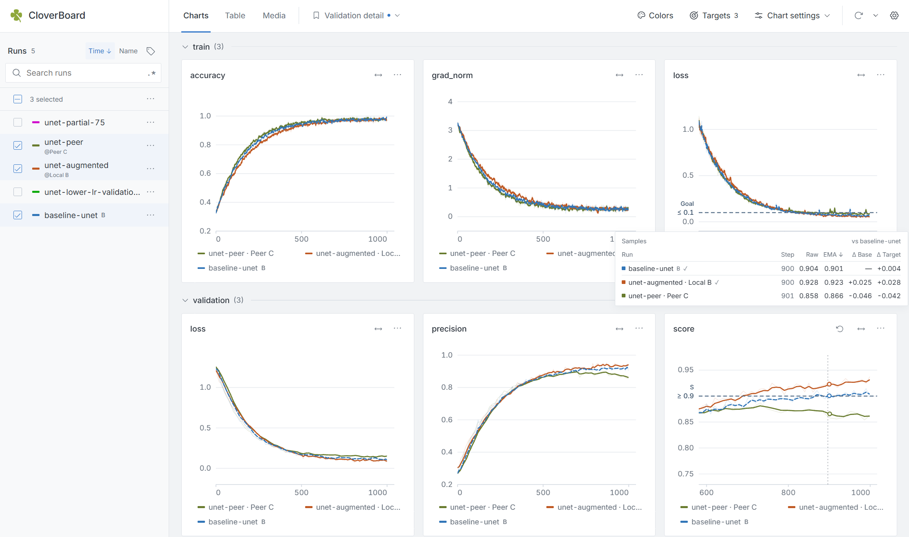
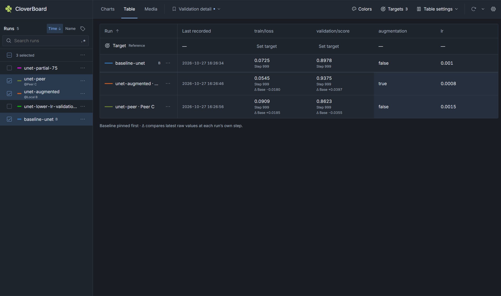

# 🍀 CloverBoard

> **Early Alpha：** CloverBoard 当前处于早期预览阶段。

为实验对比而设计的日志记录工具：在一处查看多 Run 图表、Targets、Baseline、
Tags 和 Notes。通过局域网聚合多台机器的实验，也能让 AI Agent 使用内置 MCP
端点直接检查日志。

<p align="center">
  
  
</p>

**Python 3.11+ · 本地优先 · MCP · [MIT](LICENSE)**

[English](README.md)

## 快速开始

### 1. 安装

在本仓库根目录操作，需要 Python 3.11+ 和 Node.js 20.19+（20.x）或 22.12+：

```sh
python -m pip install -e "."
npm ci --prefix web
npm run build --prefix web
```

也可以从仓库右侧的 **Releases** 下载 `.whl` 文件，使用 pip 安装。
构建好的 wheel 包含 WebUI，安装后运行无需 Node.js。

### 2. 用 Python 记录

运行下面的示例，再将演示数值替换为训练循环中的实际指标：

```python
import cloverboard as cb
from PIL import Image

cb.init(exp_name="baseline", logdir="./runs", config={"lr": 1e-3}, tags=["demo"])

for step in range(100):
    cb.log({"loss": 1 / (step + 1), "accuracy": step / 100}, step=step, group="train")

cb.log_image("validation/preview", Image.new("RGB", (64, 64), "steelblue"), step=99)
cb.log_text("validation/summary", "Baseline run completed.", step=99)
```

换一个实验名或配置再次运行，即可对比不同 Run。日志保存在 `./runs`，
每个 Run 各有一个目录和 SQLite 数据库；记录时无需启动服务。

### 3. 打开看板

```sh
cloverboard serve --logdir ./runs
```

访问 [http://127.0.0.1:7230](http://127.0.0.1:7230)。WebUI 与 MCP 端点
在同一个进程中启动。

## 四片叶子，一块看板

记录、对比、聚合、问答。

| 叶子 | 能做什么 | 适用场景 |
| --- | --- | --- |
| **Record · 记录** | 用 Python 记录标量、配置、超参数、图片、音频、文本和代码快照。 | 在现有训练循环中加入日志记录。 |
| **Compare · 对比** | 使用图表、表格、Targets、Baseline、Tags、Notes 和 View 对比实验。 | 比较学习率、数据增强、数据集或随机种子。 |
| **Aggregate · 聚合** | 在同一看板汇集本地目录和局域网 Peer。 | 实验分散在笔记本、工作站和多台 GPU 机器上。 |
| **Ask · 问答** | 通过 MCP 查询 Run、指标、配置、曲线和已记录的训练图片。 | 让 Agent 直接检查实验，无需先导出日志。 |

## 为对比而设计，具体体现在哪里

- **颜色稳定，便于辨认。** 刷新和新增 Run 时，已有实验保留各自颜色。
  支持重新分配所选实验的颜色、按超参数分族着色和自定义调色板。
  固定某个 Run 的颜色后，重新分配、切换调色板或配色模式都不会改变它。
- **Targets、Baseline 和光标处的差值。** 为整块看板选择一个 Baseline Run，
  再为各指标设置命名 Target。沿图表 Step 移动即可查看 `Δ Base` / `Δ Target`，
  Table 使用相同的对比参照。**Chart settings → Top K** 仅在 Charts 中强调领先曲线。
- **View 恢复完整的对比方式。** 实验勾选、筛选、排序、Baseline、Targets、
  配色和 Chart/Table/Media 设置都可以保存为命名 View。
  缩放、光标位置、固定读数和播放进度属于临时交互；主题与侧栏宽度是浏览器偏好。

当前观看配置会自动保存到 **Settings** 中选择的位置：**Remote workspace**（远程）
或 **Local · this browser**（本地）。普通访问默认远程，只读与 share 访问保存到本地；
View 和调色板统一使用当前保存位置。总设置也提供当前配置、View 和调色板的 JSON
导入导出，本地模式还可通过 **Restore remote settings** 恢复远程观看配置。

## 聚合与分享

在 GPU 机器上，以 Token 保护的只读模式启动服务：

```sh
cloverboard serve --logdir ./runs --host 0.0.0.0 --share
```

在自己的机器上，填入 GPU 机器的局域网地址和服务打印的 Token：

```sh
cloverboard serve --logdir ./runs --peers "gpu1=10.0.0.12:7230?token=TOKEN"
```

多个 Peer 用逗号分隔；附加本地目录使用 `--source "archive=./older-runs"`。
Peer 聚合为一级，Peer 数据只读。分享服务重启后会生成新的 Token。

也可以在浏览器中通过 GPU 机器的局域网地址和 `?token=TOKEN` 打开分享看板。
查看者可以在本地编辑、保存自己的观看配置，不会改动远程工作区或实验数据。

## 已经在用 TensorBoard？可以继续用

CloverBoard 可以使用自己的 Python SDK，也可以在不修改训练代码的情况下，
从现有 TensorBoard event 文件导入标量。TensorBoard 可与它同时运行；导入器
将数据写入 CloverBoard 日志目录，保留原始 event 文件不变。

在本仓库安装可选集成：

```sh
python -m pip install -e ".[tensorboard]"
```

终端 1：导入已有标量，并持续跟进新事件：

```sh
cloverboard import-tensorboard ./tb_logs --output ./tb_runs --follow --interval 5
```

终端 2：打开导入后的实验：

```sh
cloverboard serve --logdir ./tb_runs
```

仅导入标量。去掉 `--follow` 可执行单次导入；源目录与输出目录需要分开。

## MCP

将支持 Streamable HTTP 的 MCP 客户端连接到 `http://127.0.0.1:7230/mcp`。
端点与 WebUI 共用服务和数据来源，无需启动第二个进程。

| 数据 | 工具 |
| --- | --- |
| Run 与详情 | `list_runs`、`get_runs` |
| 指标与序列 | `list_metrics`、`get_series`、`compare_metrics` |
| 配置对比 | `compare_configs` |
| 曲线图 | `plot_metric` |
| 已记录的训练图片 | `list_image_names`、`list_images`、`get_images` |

连接分享服务时，在其地址后使用 `/mcp`，并在客户端请求头中传入
`Authorization: Bearer TOKEN`。

所有 MCP 工具均为只读，不能执行代码、启动训练或修改实验。
它们独立查询实验数据，不会继承浏览器当前的实验勾选、View 和显示设置。

## 适用场景

适合单机消融、小团队跨多台 GPU 机器对比实验，以及 Agent 辅助复盘。
训练编排和托管式云端协作不属于当前范围。

## 开发与测试

完成快速开始中的环境准备后，安装开发依赖，按需执行检查：

```sh
python -m pip install -e ".[dev]"
python -m pytest -q
npm test --prefix web
npm run build --prefix web
```

构建包含 WebUI 的 wheel：

```sh
python -m build
```

## 许可证

基于 [MIT 许可证](LICENSE) 授权。
